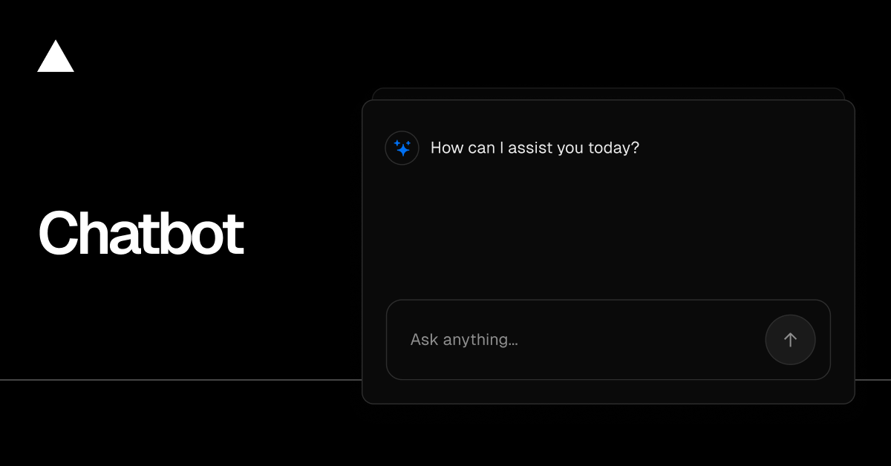

<a href="https://chatbot.ai-sdk.dev/demo">
  
  <h1 align="center">Chatbot + Raindrop</h1>
</a>

<p align="center">
  Vercel's open-source <a href="https://github.com/vercel/chatbot">Chatbot</a> template, integrated with <a href="https://raindrop.ai">Raindrop</a>. Every chat turn is sent to Raindrop with its full trace: model calls, tool calls and tool results. Use it to try Raindrop end to end, including Simulations.
</p>
<br/>

## Quick start

1. Fork this repository, then clone your fork.
2. Copy `.env.example` to `.env.local` and set two keys:
   - `RAINDROP_WRITE_KEY`: your Raindrop write key.
   - One model key: `OPENAI_API_KEY`, `ANTHROPIC_API_KEY` or `AI_GATEWAY_API_KEY`.
3. Run it (Node 22 or later; `corepack` provides the right pnpm):

   ```bash
   corepack pnpm install
   corepack pnpm dev
   ```

4. Open [localhost:3000](http://localhost:3000) and chat. You are signed in as a guest. Ask about the weather, or ask it to write an essay, some code or a spreadsheet, so its tools run.
5. Each turn shows up in Raindrop as a `chat_message` event.

No database is needed: chats, users and documents are kept in memory and are gone when the server restarts.

## Try Raindrop Simulations

Once your Raindrop project has a few `chat_message` events:

1. In Raindrop, open Simulations and connect GitHub with your fork.
2. Pick the chatbot agent and let Raindrop build its World.
3. Open a pull request that changes the agent, for example its system prompt in `lib/ai/prompts.ts`, and Raindrop replays recent conversations against your change.

## How the Raindrop integration works

- `lib/ai/raindrop.ts` creates the Raindrop client and wraps the AI SDK's `streamText` (AI SDK v7 native telemetry).
- `app/(chat)/api/chat/route.ts` sends each turn as a `chat_message` event, with the signed-in user as the user and the chat id as the conversation.
- Nothing is sent when `RAINDROP_WRITE_KEY` is unset.

## Models

- `OPENAI_API_KEY`: every chat uses OpenAI, `gpt-6-luna` by default.
- `ANTHROPIC_API_KEY`: every chat uses Anthropic, `claude-sonnet-5-5` by default.
- `AI_GATEWAY_API_KEY`: chats go through the [Vercel AI Gateway](https://vercel.com/docs/ai-gateway), and the model picker in the UI chooses the model. It takes precedence over the other two.

Set `CHAT_MODEL` to use another OpenAI or Anthropic model. The provider setup is in `lib/ai/providers.ts`.

## Optional settings

- `AUTH_SECRET`: signs session cookies. A built-in development value is used when unset; set your own when you deploy.
- `BLOB_READ_WRITE_TOKEN`: enables file uploads ([Vercel Blob](https://vercel.com/docs/vercel-blob)).
- `REDIS_URL`: enables resumable streams ([Redis](https://vercel.com/docs/redis)).

## Features

- [Next.js](https://nextjs.org) App Router with React Server Components and Server Actions
- [AI SDK](https://ai-sdk.dev/docs/introduction): text generation, tool calls and chat hooks
- Tools: current weather, and creating, editing and reviewing documents, code and spreadsheets
- [shadcn/ui](https://ui.shadcn.com) with [Tailwind CSS](https://tailwindcss.com) and [Radix UI](https://radix-ui.com)
- [Auth.js](https://authjs.dev) guest and email sign-in

## License

Apache 2.0, from [vercel/chatbot](https://github.com/vercel/chatbot). See [LICENSE](LICENSE).
